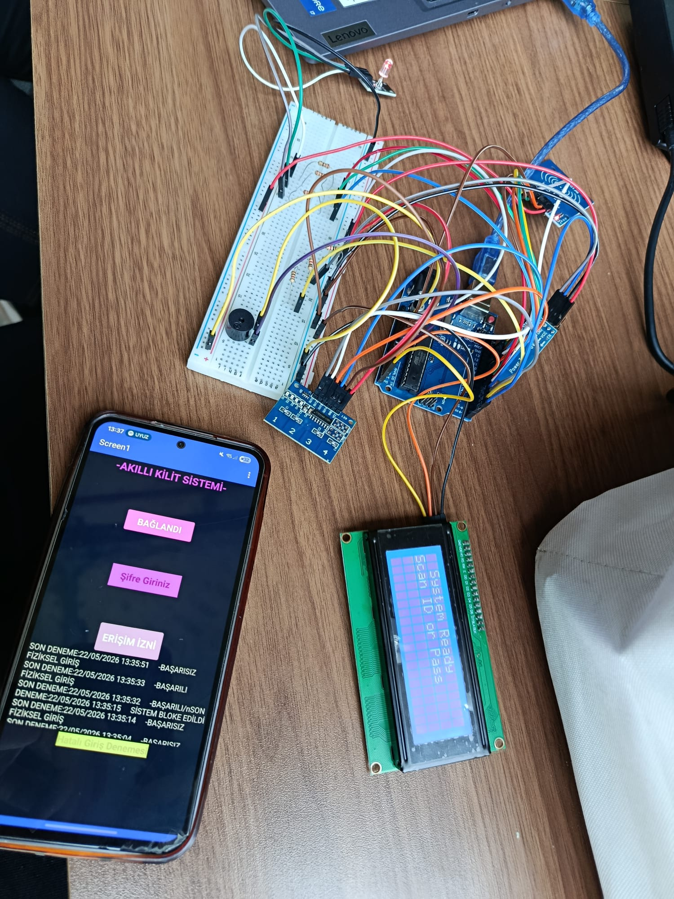

# Smart Security System

An Arduino Uno-based smart security system featuring RC522 RFID access and a TTP224 4-channel digital touch sensor for password entry, integrated with a **Processing** desktop interface via `Serial.println()` and an **MIT App Inventor** mobile application via an **HC-05** Bluetooth module.

## Key Features
- **Dual Access Control:** Authentication via authorized RFID cards/tags/chips (`23 FE DE 16`, `D3 AC 40 16`) and 4-digit password entry (`1234`) through a TTP224 4-channel digital touch sensor.
- **Lockout & Alarm Mode:** After **3 consecutive incorrect password attempts**, the system locks down and triggers alarm mode.
- **Mobile App Unlock:** Once locked, the system can only be unlocked by entering the valid password through the **MIT App Inventor** mobile app over **HC-05** Bluetooth.
- **Desktop Interface:** System status and telemetry/data are sent to a **Processing** desktop interface using `Serial.println()`.
- **Visual & Audio Feedback:** Status messages on a 16x2 I2C LCD display, state indication via a KY-016 RGB LED module, and audible alerts/alarms via a buzzer.

## Hardware Components
- 1x Arduino Uno board
- 1x RC522 RFID/NFC module (13.56 MHz, with card and key fob/tag kit)
- 1x TTP224 4-channel digital touch sensor
- 1x KY-016 RGB LED module
- 1x HC-05 Bluetooth module
- 16x2 I2C LCD display (address `0x27`)
- Buzzer
- 1x Breadboard
- Jumper wires and power supply

## Software & Tools
- **Arduino IDE** (Embedded firmware)
- **Processing** (Desktop interface via serial communication)
- **MIT App Inventor** (Mobile application via HC-05 Bluetooth)

## Pinout

| Component | Pin / Connection | Description |
| :--- | :--- | :--- |
| RFID Module (RC522, 13.56 MHz) | `SS (SDA)`: Pin `10`, `RST`: Pin `9`, `SPI`: `SCK` (13), `MOSI` (11), `MISO` (12) | RFID card/key fob reading on Arduino Uno |
| 4-Channel Touch Sensor (TTP224) | `T_PIN1`: Pin `2`, `T_PIN2`: Pin `4`, `T_PIN3`: Pin `8`, `T_PIN4`: Pin `7` | 4-channel digital touch password input |
| I2C LCD Display (16x2) | `SDA` (A4), `SCL` (A5), `VCC`, `GND` (I2C address `0x27`) | Status and prompt display |
| RGB LED Module (KY-016) | `Red`: Pin `5`, `Green`: Pin `6`, `Blue`: Pin `3` | Visual status / alarm indicator |
| Buzzer | `A3` | Audible feedback and alarm |
| Bluetooth Module (HC-05) | `[TX / RX or SoftwareSerial pins]` | MIT App Inventor communication |

## Required Libraries
- `SPI.h` (Built-in Arduino library)
- `MFRC522` (by GithubCommunity)
- `Wire.h` (Built-in Arduino library)
- `LiquidCrystal_I2C`

## How It Works
1. During normal operation, users attempt access via an authorized RFID card/key fob or enter a 4-digit password using the TTP224 4-channel touch sensor.
2. System events and status updates are transmitted to the **Processing** desktop interface via `Serial.println()`.
3. After **3 consecutive wrong password entries**, the system enters a locked state and activates the alarm (Buzzer, KY-016 RGB LED, and LCD alert).
4. While locked, unlocking is restricted to sending the correct password from the **MIT App Inventor** mobile app via the **HC-05** Bluetooth module.
## Screenshots
